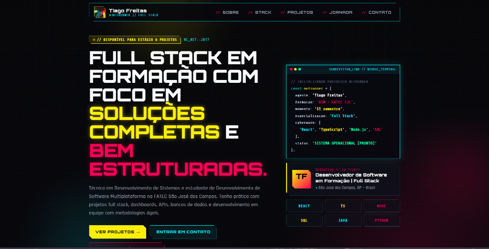

# Portfólio — Tiago Freitas

Portfólio pessoal e profissional de Tiago Freitas, estudante de Desenvolvimento de Software Multiplataforma na FATEC São José dos Campos e co-fundador da MOTUS Sports, com foco em desenvolvimento de aplicações web, mobile, APIs REST e produtos digitais.

🔗 **Link do site publicado:** [https://SEU-DOMINIO.vercel.app](https://SEU-DOMINIO.vercel.app) *(substitua pelo seu link de produção)*

---

## 📸 Preview


*(Adicione uma captura de tela do portfólio na pasta `public/` ou na raiz do repositório)*

---

## 📌 Sobre o Projeto

Este portfólio apresenta meu perfil técnico, experiências práticas, stack de tecnologias, produção científica e projetos desenvolvidos ao longo da minha trajetória acadêmica e profissional.

### Seções
- **Hero & Apresentação:** Visão geral, terminal interativo com resumo de formação e botão para download do currículo.
- **Sobre mim:** Histórico técnico e competências fundamentais.
- **Stack técnica:** Organização de habilidades por áreas (Front-end, Back-end, Dados, DevOps, Ferramentas) com níveis de proficiência.
- **Projetos:** Detalhamento estruturado com problema, solução, atuação real, impacto e tecnologias (com filtros por categoria).
- **Atuação atual:** Foco de aprendizado e desenvolvimento no momento.
- **Jornada:** Linha do tempo acadêmica, projetos integradores e produção científica.
- **Contato:** Links diretos para e-mail, LinkedIn, GitHub e download do currículo.

---

## 🚀 Projetos em Destaque

1. **MOTUS Sports** — Sporttech focada em saúde, performance e prevenção de lesões esportivas com dados e Inteligência Artificial. Co-fundador, estruturação de plataforma e back-end no programa Sebrae Supernova.
2. **Tecsus — Sistema de Coleta de Dados Meteorológicos** — Solução IoT completa com telemetria via MQTT, microsserviços e dashboards para estações meteorológicas (API FATEC | 4º Semestre).
3. **GSW — Gerenciador de Tarefas** — Plataforma web com microsserviços para centralização de tarefas, prazos e gestão de equipe (API FATEC | 3º Semestre).
4. **Helpnei — Dashboard Estratégico** — Dashboard com mapas e indicadores de impacto social e alcance de projetos (API FATEC | 2º Semestre).
5. **Transparência Legislativa SJC** — Plataforma web com web scraping automatizado e visualização de dados de vereadores de SJC (API FATEC | 1º Semestre).
6. **Cofre Digital** — Aplicativo mobile de finanças pessoais desenvolvido para apresentação acadêmica com React Native e Expo.
7. **PetLovers** — Sistema de gestão para clínicas veterinárias e pet shops com cadastro e relatórios.

---

## 🛠️ Tecnologias Utilizadas

- **Front-end:** React, TypeScript, Vite, CSS Moderno (Glassmorphism, Flexbox, Grid, Animações CSS)
- **Acessibilidade:** Padrões WCAG, atributos ARIA e navegação semântica
- **Design & Performance:** Responsividade total (mobile-first), otimização de renderização e desativação seletiva de efeitos visuais pesados em telas menores

---

## 💻 Como Rodar o Projeto Localmente

### Pré-requisitos
- Node.js (v18 ou superior recomendado)
- npm ou yarn

### Instalação e Execução

1. Clone o repositório:
```bash
git clone https://github.com/tiagow2/Portfolio-Tiago_Freitas.git
cd Portfolio-Tiago_Freitas
```

2. Instale as dependências:
```bash
npm install
```

3. Inicie o servidor em modo de desenvolvimento:
```bash
npm run dev
```

4. Para gerar a build de produção:
```bash
npm run build
```

5. Para visualizar a build localmente:
```bash
npm run preview
```
